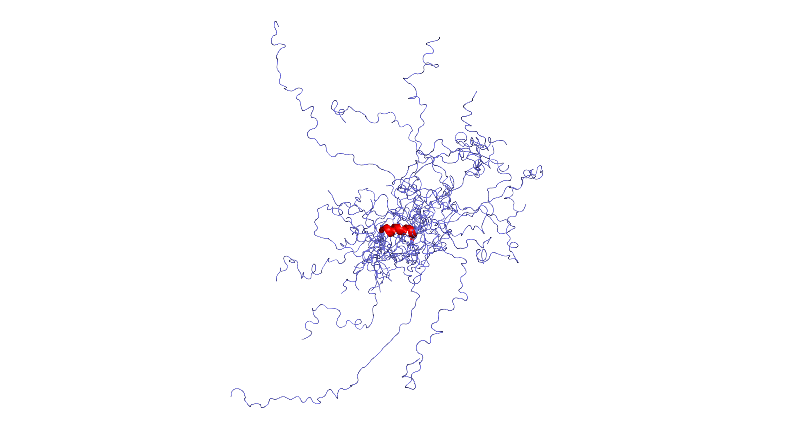
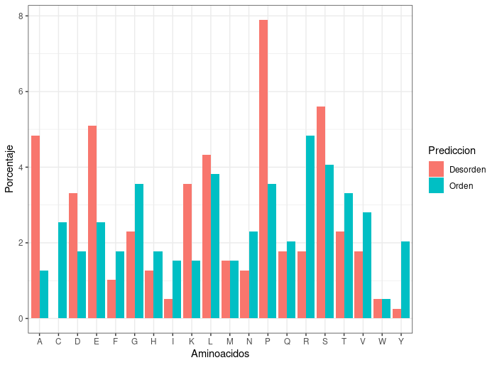

{ width="250", align="left" }

# **TP 10**. Predicción de Desorden { markdown data-toc-label = 'TP 10' }

<br>
<br>
<br>

!!! abstract "Atención: Este TP tiene informe."
!!! abstract "Atención: Este TP tiene parcialito."

[:fontawesome-solid-download: Materiales](https://drive.google.com/file/d/1wh5zn1GZ4s_Rp8V5lekZZbIKzM7BOKc8/view?usp=sharing){ .md-button .md-button--primary }
[:fontawesome-solid-file-powerpoint: Slides](https://drive.google.com/file/d/1L2LbUjMPgr5c7-hwO52QJPJ-dGeyQQZg/view?usp=sharing){ .md-button .md-button--primary } 

## **PARTE I: Predicción de Desorden**

## Recursos online
* DisProt             [https://www.disprot.org](https://www.disprot.org)
* InterPro            [https://www.ebi.ac.uk/interpro/](https://www.ebi.ac.uk/interpro/)
* ProViz              [http://slim.icr.ac.uk/proviz/](http://slim.icr.ac.uk/proviz/)
* IUPred3             [https://iupred3.elte.hu](https://iupred3.elte.hu)

## Objetivos
* Familiarizarse con la base de datos DisProt y las técnicas experimentales que permiten la identificación de regiones desordenadas.
* Integrar conocimientos de dominios conservados (InterPro) con la presencia/ausencia de estructura tridimensional.
* Interpretar alineamientos múltiples de secuencias (MSAs). 
* Identificar regiones ordenadas y desordenadas en MSAs.
* Familiarizarse con distintos métodos de predicción de desorden.


## **Métodos de predicción de desorden**

Uno de los mayores desafíos en el campo de las proteínas es la predicción de la estructura tridimensional a partir de la estructura primaria incluyendo aquellas proteínas que son total o parcialmente desordenadas. Mientras que las proteínas globulares adquieren una única estructura nativa, las proteínas intrínsecamente desordenadas (IDPs, del inglés *intrinsically disordered proteins*) son un conjunto de estructuras tridimensionales. También pueden existir regiones desordenadas conectando dos dominios globulares, como los *loops*; o incluso regiones más largas, que abarcan más de 30 residuos de longitud, que reciben el nombre de IDRs (del inglés *intrinsically disordered regions*).

En el año 2020, AlphaFold2 gana la competición de predicción de estructuras (CASP14) con un amplio margen prediciendo estructuras con muy alta precisión. Sin embargo, aún la predicción de un conjunto de estructuras para proteínas desordenadas no se ha resuelto.

La predicción de IDRs/IDPs a partir de la secuencia de aminoácidos permite un análisis rápido y abarcativo de distintas proteínas permitiendo establecer hipótesis sobre la presencia de desorden en las proteínas (Dunker et al., 2008; van der Lee et al., 2014). La importancia que adquirieron las IDRs/IDPs en los últimos años llevó al desarrollo de numerosos métodos de predicción, pero en general se basan en tres estrategias de predicción de desorden:

1. **Composición de secuencia:** como IUPred (Dosztányi et al., 2005; Erdös et al., 2021), que aplica un campo de energía estadístico desarrollado a partir de estructuras del PDB.
2. **Machine learning:** como PONDR (Obradovic et al., 2003; Romero et al., 1997), entrenado a partir de un grupo estructuras de proteínas globulares y atributos de secuencia asociados a residuos no resueltos en dichas estructuras, que corresponden a regiones flexibles dentro del cristal. GlobPlot (Linding et al., 2003) fue entrenado estudiando la tendencia de un residuo a adquirir determinada estructura secundaria, hélices α o láminas β.
3. **Meta-predictores:** que integran y ponderan los resultados de múltiples métodos individuales.


### **Parte I: Caracterización de p53** 

La proteína p53 es esencial para inducir la respuesta celular ante el daño al ADN, deteniendo el ciclo celular o induciendo apoptosis, por lo que mutaciones en la misma pueden dar como resultado distintos tipos de cáncer. Dada su importancia biomédica, es una de las proteínas más estudiadas estructural y funcionalmente.

### **Ejercicio 1.** Base de datos DisProt { markdown data-toc-label='Ejercicio 1: DisProt' } 

La base de datos [DisProt](https://disprot.org/) es una colección de evidencia de desorden experimental recolectada de la literatura y curada manualmente, e incluye por lo menos:

* un experimento,
* el artículo científico correspondiente a ese experimento,
* el inicio y final de la región desordenada en la secuencia proteica,
* un término de anotación que corresponde a la Ontología de desorden.
    
**Cada una de las entradas en la base de datos posee un identificador único**

La ontología de desorden está organizada en tres categorías diferentes:

* Estado estructural (*Structural State*): Orden o Desorden (*Order or Disorder*)
* Transición estructural (*Structural Transition*): Transiciones que pueden ocurrir entre diferentes estados estructurales (*Disorder to order*)
* Función de desorden (*Disorder Function*): La función de una región incluyendo términos específicos a desorden.

En Disprot también se incluye la función molecular *Molecular function* de cada región. 

#### ✏️ Exploración de Disprot

Ingresa a la web de DisProt y encuentra la proteína p53 (P04637). El identificador de DisProt que deberías encontrar es **DP00086**.

#### ✏️ Expande la sección *Structural state* y luego *Disorder*, y responde:

   * ¿A qué corresponden los segmentos coloreados en la secuencia?
   * ¿Qué tipo de evidencia experimental validó dichos fragmentos como desordenados?

####  ✏️  Pensando en el rol biológico de estas regiones, expande *Molecular Function* y *Disorder Function*, y responde:

   * ¿Qué tipo de funciones están indicadas para las regiones desordenadas de p53?
   * Nombra al menos dos técnicas experimentales que se hayan usado para asignar estas funciones.

### **Ejercicio 2.** Dominios conservados en InterPro { markdown data-toc-label='Ejercicio 2: InterPro' }

!!! idea "Integrando conceptos: InterPro, Pfam y HMMs"
      En el TP de HMMs aprendimos a identificar dominios conservados en proteínas utilizando bases de datos de perfiles como **Pfam** a través de **InterPro**. 

#### ✏️ Observando dominios en InterPro

Observa la línea de **InterPro** dentro de la misma página de DisProt (Ojo! En DisProt se indican los InterPro Domains que corresponden a Pfam domains) o bien busca P04637 directamente en la web de [InterPro](https://www.ebi.ac.uk/interpro/) y enfócate en los dominios de la base de datos **Pfam**. 

#### ✏️ Preguntas

* ¿Cuántos dominios conservados distintos muestra Pfam para p53?

* Contrastando con la información vista en el Ejercicio 1: Las regiones validadas experimentalmente como "desordenadas" en DisProt, ¿coinciden con la presencia o con la ausencia de dominios Pfam? 

* Biológica y estructuralmente, ¿por qué crees que sucede esto?

---
## **PARTE II: Análisis de Regiones Desordenadas a través de Alineamientos Múltiples de Secuencia (MSAs)**

!!! idea "Antes de seguir, piensen ..."

      ¿Porqué es importante visualizar un MSA?
      
      ¿Qué información podemos obtener de los MSA?

**ProViz** es una herramienta que permite visualizar alineamientos y estructura de dominios de una proteína online. 


### **Ejercicio 1.** Explorando Alineamientos de Secuencia Online  { markdown data-toc-label='Ejercicio 1: Proviz' }

Ingresa a la web de [**ProViz**](http://slim.icr.ac.uk/proviz/), y busca la proteína p53 ingresando su Accession Number en la ventana “search” (Accession Number: P04637): 

#### ✏️ Explora p53 en Proviz

Selecciona la proteína que se llama: [Cellular tumor antigen p53 (TP53) Homo sapiens (Human)](http://slim.icr.ac.uk/proviz/proviz.php?uniprot_acc=P04637). Es la primera de la lista.

!!! danger "IMPORTANTE"

      Para responder las preguntas debajo, asegúrate de que en el panel superior de la página, en **alignments**, esté seleccionada la opción **QFO**. (Puedes investigar qué pasa si cambian a otras opciones, como *metazoa* o *vertebrates*).

#### ✏️ Preguntas

* Observa la secuencia de *Oryzias latipes*, ¿puedes encontrar letras minúsculas? ¿A qué se deben?

??? tip "Pista"

      Esa región no posee posiciones homólogas en la secuencia humana de p53, y por lo tanto, se perderían las anotaciones de dominios y estructuras, para evitarlo, todas las regiones que no tienen posiciones homólogas en p53 humana fueron recortadas.

* ¿Hay regiones de las secuencias que tengan más minúsculas? (N-terminal, C-terminal, o la región central)

* ¿Qué regiones parecen estar mejor alineadas (indicar aproximadamente de qué posición a qué posición de la primera secuencia)?

* ¿Existen diferencias en la composición de secuencia entre las regiones mejor alineadas y las no tan bien alineadas?

* ¿Se observan diferencias en el grado de conservación de estas regiones?

* ¿A qué pueden deberse las diferencias observadas?


### **Ejercicio 2.** Opción Local: Análisis con JalView { markdown data-toc-label='Ejercicio 2: JalView' }

Jalview es un software robusto que permite generar, editar, analizar y colorear alineamientos localmente.

Jalview lo puedes descargar para tu sistema operativo desde: [Jalview - Downloads](https://www.jalview.org/download/)

#### ✏️ Preguntas

* Abre JalView (ejecutando el programa en tu computadora). Descarga y abre el conjunto de secuencias p53.fasta proporcionado en los materiales:

      *File* → *Input Alignment* → *From File*

* Para realizar el alineamiento, usaremos Clustal de manera remota:

      *Web Service* → *Alignment* → *Clustal* → *With defaults*

      (Nota: Si el servicio falla, abre directamente el archivo p53_aligned.fasta que ya se encuentra alineado).

* Edición del alineamiento:

      Si algunas secuencias son mucho más cortas o están truncadas, pueden generar ruido. Selecciona el nombre de la secuencia a la izquierda y bórrala (teclas ++backspace++ o ++del++).


      * ¿Por qué creen que algunas secuencias son más cortas? ¿Todas empiezan con metionina? ¿Todas incluyen todas las regiones de p53?
      
      * ¿Por qué creen que es importante filtrar el alineamiento inicial?

* Análisis por colores. Colorea el alineamiento:

      *Colour* → *Clustal*

      Este esquema colorea por propiedades fisicoquímicas, pero la intensidad depende de la conservación. Explore a qué corresponde cada color de Clustal en el [esquema de colores](https://www.jalview.org/help/html/colourSchemes/clustal.html)

      * ¿Qué observa respecto de la coloración de las cisteínas? ¿Es siempre igual? ¿A qué se debe?

      * ¿Hay residuos que siempre están coloreados? ¿Cuáles son y a qué cree que se debe?

* Filtro de Identidad.

      Modifica el umbral de identidad y observa qué regiones sobreviven al 80% o al 100%.

      *Colour* → *Above identity threshold*

      * ¿Qué regiones muestran una identidad de secuencia mayor al 80%? ¿Coinciden estas regiones con los dominios encontrados en InterPro o con las regiones ordenadas de DisProt?

* Observando las regiones variables, ¿qué tipos de sustituciones observa? ¿Qué relación guardan con las matrices BLOSUM o PAM?


---

## **PARTE III: Predicción de Desorden**

Uno de los mayores desafíos en el campo estructural es la predicción de proteínas intrínsecamente desordenadas (IDPs) o regiones desordenadas (IDRs). A diferencia de las proteínas globulares, las IDPs consisten en un ensamble (conjunto) dinámico de conformaciones.
Existen distintas estrategias para predecir desorden a partir de la secuencia: algoritmos basados en la composición de aminoácidos (como IUPred), algoritmos de *machine learning* entrenados con cristalografía (PONDR, GlobPlot), y meta-predictores.

### **Ejercicio 1.** IUPred3 Web para una secuencia { markdown data-toc-label='Ejercicio 1: IUPred3 Web' }

!!! info "Score IUPred"
    En general se considera que un residuo es:
    
    * **Desordenado** cuando el valor de IUPred es mayor o igual a 0.5
    * **Ordenado** cuando es menor a 0.5

     **Nota:** Esta es una convención. El umbral lo puede decir el usuario a su propia conveniencia.
     
    Es posible utilizar la web de  [**IUPred3**](https://iupred3.elte.hu/){ target="_blank" } para realizar una predicción rápida.


####  ✏️  Predicción de desorden Online

* Ingresa el Accession Number de p53 (P04637) en la web. Selecciona el tipo de predicción *Long disorder*.

* Observa el gráfico interactivo resultante. ¿Las regiones predichas como desordenadas por el algoritmo (score $\ge$ 0.5) coinciden con la evidencia experimental que se vió previamente en DisProt?

* Repetí el primer paso, ingresando el Accession Number de p53 (P04637) en la web, pero esta vez seleccionando el tipo de predicción *Short disorder*. ¿El gráfico coincide con el correspondiente a *Long disorder*? A qué se deben esas diferencias?  

### **Ejercicio 2.** Análisis de múltiples secuencias con IUPred3 en Google Colab (Python) { markdown data-toc-label='Ejercicio 2: IUPred3 Colab' }

Además de la versión web, IUPred3 puede utilizarse de manera local; imaginemos que queremos analizar la conservación del desorden en decenas de ortólogos de p53. El visualizador web no es práctico para analizar muchas secuencias a la vez.

Primero, usaremos una sola secuencia (`P53_HUMAN`) para predecir el desorden mediante IUPred3, y graficaremos los resultados usando los paquetes `matplotlib` y `seaborn` de Python.   

Luedo, utilizaremos la librería **Biopython** para extraer cada secuencia de nuestro archivo multi-FASTA, ejecutaremos el algoritmo de **IUPred3** desde Python usando comandos del sistema, y consolidaremos los datos para generar un gráfico superpuesto.

#### ✏️ Preparación del entorno y descarga de archivos

* En tu primera celda de código de Colab, instala Biopython y trae los archivos desde la carpeta de materiales de la materia:

!!! info "¿Qué es Biopython?"

      Biopython es un conjunto de herramientas de Python diseñadas específicamente para resolver tareas de biología computacional. En este TP utilizaremos su módulo SeqIO (Sequence Input/Output), que nos permite leer el archivo multi-FASTA, separar automáticamente las secuencias y acceder a sus propiedades (como el nombre o los aminoácidos) de forma muy sencilla, ahorrándonos el trabajo de tener que programar el recorte del texto a mano.

```bash
# Instalamos Biopython
!pip install biopython

# Descargamos el algoritmo IUPred3
!gdown "https://drive.google.com/uc?id=1TgHdeQAOzZJk3Yln1zlnbZYAHMI6P1G8" -O iupred3.tar.gz

# Descargamos la secuencia de p53 correspondiente a humanos
!gdown "https://drive.google.com/uc?id=1_r4e6YsUYEUWYklPiK_w9V8-d1rlKvoD" -O P53_HUMAN.seq

# Descargamos el archivo multi-FASTA con ortólogos de p53
!gdown "https://drive.google.com/uc?id=18okcmG93WN847Z-X3xWli6sHH8eW7s_0" -O p53_aligned.fasta

# Descomprimimos el algoritmo
!tar -xzf iupred3.tar.gz
```

```bash
# Examinar el contenido de los archivos descargados (Opcional)
!head -n 5 P53_HUMAN.seq

!head -n 5 p53_aligned.fasta
```

#### ✏️ Ejecutamos IUPred3 para P53_HUMAN

```bash
# Corremos la predicción pasándole nuestro archivo de secuencia
!python iupred3/iupred3.py -a P53_HUMAN.seq long > P53_HUMAN_long.iupred
```
#### ✏️ Ahora vamos a crear un script para procesar el resultado usando `pandas`, y crear nuestro propio gráfico con `matplotlib`.
```Python
import pandas as pd
import numpy as np
import matplotlib.pyplot as plt

# 1. Leemos el archivo (usamos r"\s+" para que separe bien las columnas sin dar alertas)
fileIN = "P53_HUMAN_long.iupred"
header = ["Posicion", "Aminoacido", "Iupred", "Anchor"]
p53 = pd.read_csv(fileIN, sep=r"\s+", names=header, comment="#", skipinitialspace=True)

# 2. Armamos el gráfico imitando la web de IUPred3
plt.figure(figsize=(10, 4))

# Graficamos la curva de predicción en rojo
plt.plot(p53['Posicion'], p53['Iupred'], color='red', linewidth=1.5)

# Trazamos la línea negra en el umbral de 0.5
plt.axhline(y=0.5, color='black', linestyle='-', linewidth=1.5)

# Ajustamos los bordes y etiquetas
plt.ylim(0, 1)
plt.xlim(0, p53['Posicion'].max())
plt.xlabel('Posición (Aminoácido)', fontsize=12)
plt.ylabel('Score IUPred3', fontsize=12)
plt.title('Predicción de Desorden (IUPred3) - p53', fontsize=14)
plt.grid(True, linestyle=':', alpha=0.6)

plt.tight_layout()
plt.show()
```
#### ✏️ Ejecutamos IUPred3 para múltiples secuencias

Sin embargo, si uno quisiera ver la conservación del desorden, sería interesante poder visualizar en un mismo gráfico todos los Score de IUPred de todas las secuencias juntas. Pero, primero hay que alinear el score de IUPred de cada posición de cada secuencia a las posiciones del alineamiento.
* Vamos a leer el archivo multi-FASTA, extraer cada secuencia de forma individual usando `BioPython`, correr IUPred3 y unir todas las tablas resultantes en un único DataFrame de Pandas.


```Python
import os
import pandas as pd
import numpy as np
import matplotlib.pyplot as plt
from Bio import SeqIO

# 1. Leemos todas las secuencias del archivo multi-FASTA ALINEADO
secuencias = list(SeqIO.parse("p53_aligned.fasta", "fasta"))
lista_de_tablas = []
nombres_columnas = ["Posicion", "Aminoacido", "Iupred", "Anchor"]

print(f"Procesando {len(secuencias)} secuencias. Esto puede tardar un momento...")

for i, secuencia_actual in enumerate(secuencias):
    # Tomamos el nombre de la secuencia
    nombre_proteina = secuencia_actual.id.split("|")[-1] 
    
    # Extraemos los aminoácidos como una cadena de texto (string)
    secuencia_con_gaps = str(secuencia_actual.seq)
    
    # El método .replace("-", "") busca los guiones y los elimina (los reemplaza por vacío)
    secuencia_sin_gaps = secuencia_con_gaps.replace("-", "")

    # Nombres de los archivos
    archivo_secuencia = f"secuencia_{i}.seq"
    archivo_resultado = f"resultado_{i}.iupred"

    # 2. Guardamos la secuencia SIN GAPS en la computadora de Colab
    # open() con el modo "w" (write) abre o crea un archivo para que podamos escribir en él
    with open(archivo_secuencia, "w") as f:
        f.write(f">{nombre_proteina}\n{secuencia_sin_gaps}")

    # 3. Ejecutamos IUPred3 mandando el comando a la terminal del sistema
    # os.system() permite ejecutar comandos de Bash (Linux) desde un script de Python
    comando = f"python iupred3/iupred3.py -a {archivo_secuencia} long > {archivo_resultado}"
    os.system(comando)

    # 4. Leemos el resultado crudo (que es más corto porque no tiene los gaps)
    tabla_individual = pd.read_csv(archivo_resultado, sep="\t", names=nombres_columnas, comment="#", skipinitialspace=True)
    
    # .tolist() convierte la columna de la tabla de Pandas en una lista básica de Python
    scores_iupred = tabla_individual["Iupred"].tolist()

    # 5. MAPEO: Reconstruimos la tabla respetando los espacios del alineamiento original
    scores_finales = []
    posiciones_alineadas = []
    indice_sin_gaps = 0
    
    for pos, aminoacido in enumerate(secuencia_con_gaps):
        posiciones_alineadas.append(pos + 1)
        
        if aminoacido == "-":
            # np.nan (Not a Number) representa un dato nulo/vacío en la tabla
            scores_finales.append(np.nan)
        else:
            # Si hay un aminoácido, tomamos el siguiente score que calculó IUPred3
            scores_finales.append(scores_iupred[indice_sin_gaps])
            indice_sin_gaps += 1
            
    # Armamos la tabla final para esta proteína
    tabla_alineada = pd.DataFrame({
        "Posicion_Alineamiento": posiciones_alineadas,
        "Aminoacido": list(secuencia_con_gaps),
        "Iupred": scores_finales,
        "Proteina": nombre_proteina
    })

    # Guardamos esta tabla en nuestra lista
    lista_de_tablas.append(tabla_alineada)

# 6. Unimos todas las tablas pequeñas en una sola tabla grande
# pd.concat() agarra una lista de DataFrames y los pega uno debajo del otro
tabla_general = pd.concat(lista_de_tablas, ignore_index=True)

# Clasificamos según el umbral de 0.5 (los NaN de la columna Iupred darán falso temporalmente)
tabla_general['Prediccion'] = np.where(tabla_general['Iupred'] >= 0.5, 'Desorden', 'Orden')

tabla_general.loc[tabla_general['Aminoacido'] == '-', 'Prediccion'] = None

# Vemos las primeras filas
tabla_general.head()
```

#### ✏️ Gráfico de conservación del desorden (Media y Desvío)

Para ver el cómo se conserva el desorden en secuencias homólogas de p53, vamos a graficar todas las curvas individuales superpuestas. Por encima, calcularemos y graficaremos la línea media junto a una franja sombreada que represente el desvío estándar.

```Python
plt.figure(figsize=(12, 5))

# 1. Graficamos todas las secuencias individuales superpuestas

# Ordenamos los datos por la posición (eje X) para evitar que Matplotlib dibuje líneas extrañas hacia atrás si las filas llegan desordenadas
for proteina_nombre, group in tabla_general.groupby('Proteina'):

      group = group.sort_values('Posicion_Alineamiento')

      plt.plot(group['Posicion_Alineamiento'], group['Iupred'],
      alpha=0.5, linewitdth=1) # Usamos alpha=0.5 para que las líneas sean semitransparentes y formen el fondo

# 2. Creamos una tabla con la media y el desvío estándar 
tabla_estadisticas = tabla_general.groupby('Posicion_Alineamiento')['Iupred'].agg(['mean', 'std']).reset_index()

# Opcional: ver cómo queda la nueva tabla
# print(tabla_estadisticas.head())

# 3. Graficar la línea de la media
plt.plot(tabla_estadisticas['Posicion_Alineamiento'], tabla_estadisticas['mean'],
         color='black', linewidth=1.5, label='Media')

# 4. Graficar el área sombreada correspondiente al desvío estándar
plt.fill_between(tabla_estadisticas['Posicion_Alineamiento'],
                 tabla_estadisticas['mean'] - tabla_estadisticas['std'],  # Límite inferior
                 tabla_estadisticas['mean'] + tabla_estadisticas['std'],  # Límite superior
                 color='black', alpha=0.2, label='± Desvío Estándar')     # alpha controla la transparencia

plt.xlabel('Posicion_Alineamiento')
plt.ylabel('Iupred')
plt.legend()

plt.axhline(y=0.5, color='red', linestyle='--', linewidth=1.5, label='Umbral (0.5)')
plt.ylim(0, 1)
plt.xlim(0, tabla_general['Posicion_Alineamiento'].max())

plt.xlabel("Posición en el Alineamiento Múltiple", fontsize=12)
plt.ylabel("Score IUPred3", fontsize=12)
plt.title("Conservación del desorden en homólogos alineados de p53", fontsize=14)

plt.grid(True, linestyle=':', alpha=0.7)
plt.legend(loc='upper right')
plt.tight_layout()
plt.show()

```

#### ✏️ Preguntas

Observa el gráfico generado con las secuencias superpuestas y la tendencia central, y responde:

* La línea negra marca la tendencia general de la familia p53. ¿Qué regiones (N-terminal, central, C-terminal) muestran mayor propensión al desorden? ¿Qué regiones corresponden a los dominios?

* ¿Existen regiones en el alineamiento con alta dispersión en los scores de desorden? ¿A qué características biológicas o del propio alineamiento se lo podrías atribuir?

#### ✏️ Análisis de composición: 

Según la teórica, las regiones desordenadas de las proteínas suelen estar empobrecidas en aminoácidos hidrofóbicos y enriquecidas en residuos polares, cargados y prolina. 

Aprovechemos nuestro DataFrame `tabla_general` (que contiene todas las secuencias alineadas) para comprobar si esta regla se cumple en las secuencias homólogas de p53. Vamos a graficar qué aminoácidos son más frecuentes en las regiones desordenadas en comparación con las estructuradas.

Como armar este tipo de gráficos comparativos paso a paso con Matplotlib requiere varias líneas de cálculo extra, vamos a aprovechar para sumar una herramienta nueva a nuestro repertorio:

!!! info "¿Qué es Seaborn y para qué sirve el parámetro `hue`?"
    Para este último gráfico utilizamos **Seaborn** (`sns`), una librería de visualización de datos construida "por encima" de Matplotlib. Su principal ventaja es que está optimizada para trabajar directamente con DataFrames de Pandas, simplificando en muchos casos el código necesario para hacer gráficos estadísticos. 
    El parámetro `hue` sirve para subdividir visualmente los datos basándose en una columna extra. Al agregar `hue='Prediccion'`, le damos una instrucción muy concreta: **separá el conteo de cada aminoácido en subgrupos ('Orden' y 'Desorden') y asignale un color a cada uno**. 
    De esta manera, Seaborn cuenta, clasifica y agrupa las barras de forma totalmente automática, ahorrándonos tener que separar la tabla con cálculos manuales.
    
``` Python
import seaborn as sns

plt.figure(figsize=(12, 5))

# Filtramos los gaps para que no se cuenten como si fueran aminoácidos
datos_sin_gaps = tabla_general[tabla_general['Aminoacido'] != '-']

# El gráfico cuenta automáticamente cuántas veces aparece cada aminoácido en la tabla
sns.countplot(data=datos_sin_gaps, x='Aminoacido', hue='Prediccion', 
              palette={'Desorden':'red', 'Orden':'blue'}, 
              order=datos_sin_gaps['Aminoacido'].value_counts().index)

plt.title('Abundancia de Aminoácidos: Orden vs Desorden en homologos de p53')
plt.ylabel('Cantidad total de residuos')
plt.grid(axis='y', linestyle=':', alpha=0.7)
plt.show()
```
Deberías obtener un gráfico similar al siguiente:



#### ✏️ Responder

* Observando el gráfico generado, se cumple la regla teórica para la composición de las regiones desordenadas? Si encontraste excepciones (por ejemplo, residuos polares con mayor abundancia en regiones ordenadas), ¿a qué factores se pueden atribuir? 


## **Ejercicio a informar** 


!!! info
      Fecha límite de entrega: **Viernes 30 de octubre de 2026, 23:59 hs**. Enviar a: pnunez@iib.unsam.edu.ar, incluyendo en copia a jglavina@iib.unsam.edu.ar y al resto de los miembros del grupo.

**Enunciado**

El Receptor de Estrógenos alfa (ESR1) es un receptor nuclear de hormonas que regula la expresión génica, afectando procesos vitales como la proliferación y diferenciación celular en tejidos diana. Su activación depende de la unión a un ligando, lo cual induce un cambio conformacional que le permite unirse al ADN o asociarse de forma combinatoria con múltiples complejos coactivadores y otros factores de transcripción.

Para mediar esta red de interacciones, ESR1 posee una arquitectura modular que combina regiones rígidamente estructuradas (como los dominios de unión al ligando y al ADN) con extensas regiones flexibles. Dada su relevancia en la proliferación celular, las alteraciones en su funcionamiento o expresión son un motor principal en el desarrollo de patologías como el cáncer de mama.

En este trabajo, el objetivo será caracterizar a ESR1 integrando bases de datos de proteínas, predicciones de desorden y evidencia experimental, para luego analizar sus implicancias biomédicas.

**Archivos de trabajo**

* `ESR1_aligned.fasta` - Alineamiento múltiple de secuencias homólogas de ESR1. Descargar desde Google Colab ejecutando el siguiente comando en su notebook de Colab: 
```bash
!wget "https://drive.google.com/uc?id=1A2emLqaaTGfx5xGcOekwAcyKxOhecB81" -O ESR1_aligned.fasta
```

**Consignas**

**1. Caracterización de dominios:** Buscar información sobre del receptor de estrógenos humano (UniProt ID: P03372). Utiliza las plataformas que conocen (ProViz, InterPro) para explorar la anotación de dominios presentes en esta proteína.

* Qué regiones de la secuencia corresponden a dominios conocidos y cuáles carecen de anotación de dominios globulares conocidos? 

**2. Predicción de desorden:** Aplicando la metodología que se vió en el TP para el uso de IUPred3, procesar la predicción de desorden de las secuencias de ESR1. Generar el perdil de desorden de todas las secuencias en un solo gráfico.

 * Identificar qué regiones de la proteína muestran tendencia al desorden y cuáles a adoptar estructuras globulares, coinciden con las anotaciones de dominios de las bases de datos?

 * Observando la dispersión de los scores entre las distintas secuencias, ¿qué diferencias de conservación notás entre las regiones ordenadas y las desordenadas?

**3. Validación Experimental (DisProt):** Buscar ESR1 humano en la base de datos DisProt.

* Existen datos experimentales que confirmen la presencia de desorden en esta proteína?

* Contrasten la evidencia experimental con las predicciones de IUPred3 que obtuvieron. ¿Coinciden? En caso de observar discrepancias (por ejemplo, regiones anotadas en DisProt pero no predichas por IUPred3, o viceversa), discutan brevemente a qué factores biológicos o técnicos podrían deberse.

**4. Importancia Biomédica y Farmacológica:** a partir de la caracterización de ESR1 y de la búsqueda de bibliografía analizar: 

 * ¿Qué rol funcional cumple la plasticidad estructural de ESR1 (tener dominios plegados combinados con extensas regiones desordenadas) en su mecanismo biológico?

 * Sabiendo que los fármacos clásicos suelen diseñarse para encajar en los "bolsillos" tridimensionales de los dominios globulares, ¿qué desafíos u oportunidades presenta la presencia de las regiones intrínsecamente desordenadas para el desarrollo de nuevas terapias dirigidas contra esta proteína?


<!--
---
## **Ejercicio a informar**
!!! danger "Entrega"
**Fecha límite de entrega: viernes 23/10, 23:59hs.** 
 { markdown data-toc-label='Entrega de informe' }

**Enunciado**

Las ciclinas son proteínas que regulan el ciclo celular uniéndose y activando a las quinasas dependientes de ciclinas (CDKs). Dada su relevancia, su disfunción contribuye al desarrollo de diversas enfermedades, incluyendo el cáncer.
La ciclina CCND1 (P24385, ciclina D1) es un regulador clave en la transición de la fase G1 a la fase S. Las ciclinas CCND2 (P30279, ciclina D2) y CCND3 (P30281, ciclina D3) tienen funciones estructurales similares a D1, pero se expresan en distintos tejidos.

En tu laboratorio de bioinformática están interesados en estudiar la estructura de estas tres ciclinas para futuros ensayos de docking.

**1 Predicción:** Usando tu pipeline de Colab (IUPred3), procesa e identifica el porcentaje de regiones desordenadas y globulares en las tres ciclinas. Genera los perfiles de desorden.

**2. Alineamiento de secuencias:** Busca la composición de dominios Pfam. Crea un alineamiento múltiple (MSA) de las tres secuencias utilizando JalView. ¿Qué nivel de conservación observas en las regiones desordenadas vs. los dominios Pfam?

**3. Validación:** Búscalas en DisProt. ¿Existen datos experimentales de desorden para estas proteínas? ¿Coinciden con las predicciones computacionales obtenidas en el punto 1?


---

## Ejercicios Adicionales (Opcionales)

### **Ejercicio Adicional 1. Búsqueda de sitios de unión a IDPs (ANCHOR)** { markdown data-toc-label='Ejercicio Adicional 1' }

Muchas proteínas desordenadas ejercen su función uniéndose a un partner globular, mediante una transición acoplada de plegamiento y unión (folding upon binding). ANCHOR es un algoritmo que identifica estos posibles sitios de unión dentro de regiones desordenadas.

**1.1** En el servidor web de IUPred3, asegúrate de activar la opción ANCHOR en Context-dependent predictions para p53.

 * ¿Cuántas regiones de interacción identifica la curva azul (ANCHOR)?

**1.2** Ingresa a la base de datos [IDEAL](https://www.ideal-db.org/) y busca P53_HUMAN. Esta base de datos anota Protean Segments (ProS) con confirmación estructural.

* En la región C-terminal, ¿a cuántas proteínas distintas se une p53? (Revisa el link "complex").

* ¿Qué tipo de estructura secundaria (hélice, lámina, coil) adquiere ese segmento al unirse a distintos partners?

**1.3** ¿Cuán precisas resultaron las predicciones ab initio de ANCHOR respecto a los complejos cristalizados reportados en IDEAL?

### **Ejercicio Adicional 2. Proteínas Extremas** { markdown data-toc-label='Ejercicio Adicional 2' }

**2.1** Busca la entrada DP00039 en DisProt. Corre IUPred3 para su secuencia.

**2.2** Utiliza un script de Python o el servidor ProtParam (https://web.expasy.org/protparam/{ target="_blank" }) para contar la cantidad de aminoácidos con carga positiva vs negativa. Calcula su carga neta.

**2.3** Observa los dominios que propone InterPro. ¿Existen contradicciones lógicas entre la asignación de familias y el altísimo desorden predicho?

-->


